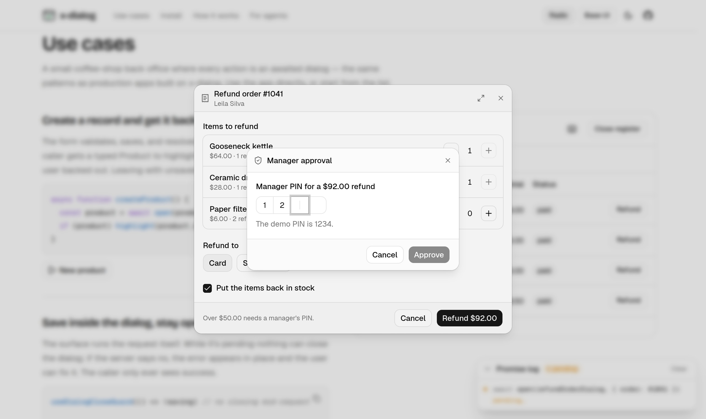
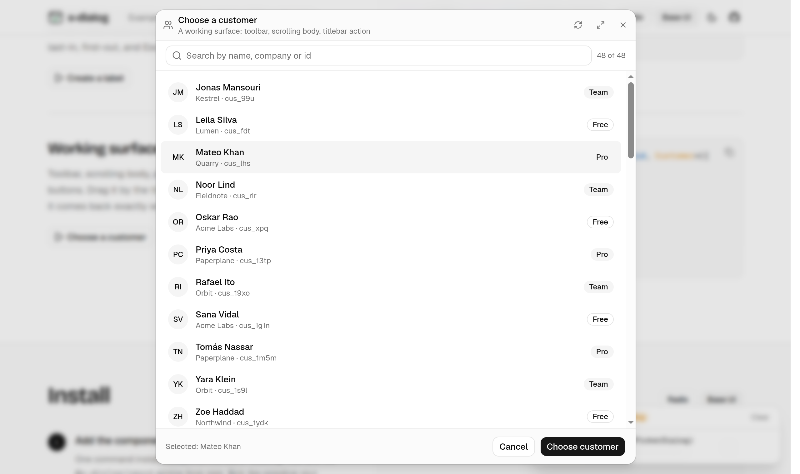
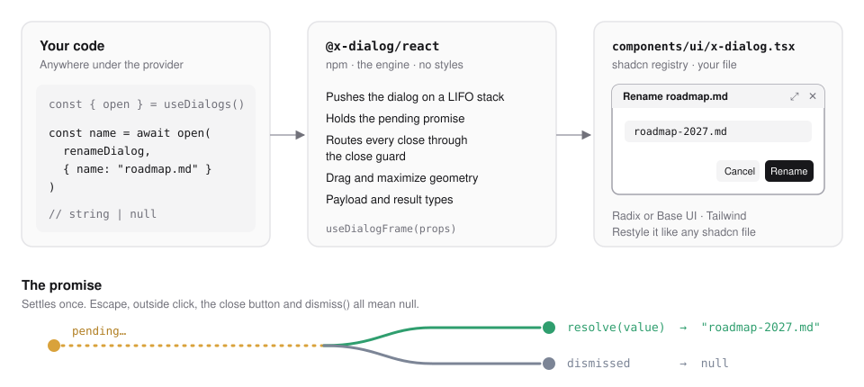

<div align="center">

<picture>
  <source media="(prefers-color-scheme: dark)" srcset=".github/assets/hero-dark.png">
  
</picture>

# x-dialog

**Dialogs you can `await`.** Declare a dialog once, open it from anywhere, get a typed result back.<br>
Drag, maximize, stack and guard them. Rendered with the shadcn primitives you already use — Radix or Base UI.

[](https://www.npmjs.com/package/@x-dialog/react)
[](https://github.com/AbdenourTadjer33/x-dialog/actions/workflows/ci.yml)
[](https://bundlephobia.com/package/@x-dialog/react)
[](./LICENSE)

[**Live demo**](https://abdenourtadjer33.github.io/x-dialog/) · [Docs](./docs/api.md) · [Recipes](./docs/recipes.md) · [For AI agents](#for-ai-agents)

</div>

```tsx
const { open } = useDialogs()

const name = await open(renameDialog, { name: file.name })
//    ^? string | null
if (name === null) return // dismissed

await rename(file, name)
```

No `isOpen` state. No `onConfirm` callbacks threaded through three components. No dialog
registry to keep in sync. The call site reads top to bottom, and the compiler checks the
payload and types the result.

## Contents

- [Why](#why)
- [Install](#install)
- [Quick start](#quick-start)
- [What you get](#what-you-get)
- [How it works](#how-it-works)
- [API at a glance](#api-at-a-glance)
- [For AI agents](#for-ai-agents)
- [FAQ](#faq)

## Why

The usual dialog lives in the component that renders it: a `useState` for open, another for
the draft value, an `onConfirm` prop, and a `useEffect` to reset it. Asking the user one
question costs you a component's worth of plumbing, and the answer arrives in a callback
far from the code that asked.

x-dialog turns the question into a function call:

<table>
<tr><th>Before</th><th>After</th></tr>
<tr>
<td>

```tsx
const [open, setOpen] = useState(false)
const [target, setTarget] = useState<File>()

<Button onClick={() => {
  setTarget(file)
  setOpen(true)
}} />

<RenameDialog
  open={open}
  onOpenChange={setOpen}
  file={target}
  onConfirm={(name) => {
    rename(target!, name)
    setOpen(false)
  }}
/>
```

</td>
<td>

```tsx
const { open } = useDialogs()

<Button onClick={async () => {
  const name = await open(renameDialog, {
    name: file.name,
  })
  if (name) rename(file, name)
}} />
```

</td>
</tr>
</table>

It has been used in production across several apps before being extracted into this package.

## Install

x-dialog has two halves, installed together with one command:

- **`@x-dialog/react`** from npm: the engine (stack, promises, guards, geometry, types). You update it like any dependency.
- **`components/ui/x-dialog.tsx`** from the shadcn registry: the frame (markup and Tailwind classes). It's your file to restyle.

Pick the primitive your shadcn project uses (`base` in `components.json` tells you):

```bash
# Radix
npx shadcn@latest add AbdenourTadjer33/x-dialog/x-dialog-radix

# Base UI
npx shadcn@latest add AbdenourTadjer33/x-dialog/x-dialog-base
```

Requirements: React 18 or 19, Tailwind CSS v4, and a shadcn project (`components.json`).

## Quick start

**1. Mount the provider once**, near the root and inside your other providers, so dialogs can use them:

```tsx
import { DialogProvider } from "@/components/ui/x-dialog"

export function Providers({ children }: { children: React.ReactNode }) {
  return <DialogProvider>{children}</DialogProvider>
}
```

**2. Declare a dialog.** A surface is a plain component. The definition _is_ the handle:

```tsx
import {
  Dialog,
  defineDialog,
  type DialogProps,
} from "@/components/ui/x-dialog"

function RenameSurface({
  payload,
  resolve,
  dismiss,
}: DialogProps<{ name: string }, string>) {
  const [name, setName] = useState(payload.name)

  return (
    <form
      className="contents"
      onSubmit={(e) => {
        e.preventDefault()
        resolve(name)
      }}
    >
      <Dialog.Body>
        <Input
          data-autofocus
          value={name}
          onChange={(e) => setName(e.target.value)}
        />
      </Dialog.Body>
      <Dialog.Footer>
        <Button type="button" variant="outline" onClick={dismiss}>
          Cancel
        </Button>
        <Button type="submit">Rename</Button>
      </Dialog.Footer>
    </form>
  )
}

export const renameDialog = defineDialog<{ name: string }, string>({
  kind: "rename",
  title: (payload) => `Rename ${payload.name}`,
  width: "sm",
  component: RenameSurface,
})
```

**3. Await it anywhere** under the provider:

```tsx
const { open } = useDialogs()
const name = await open(renameDialog, { name: "roadmap.md" }) // string | null
```

## What you get

<picture>
  <source media="(prefers-color-scheme: dark)" srcset=".github/assets/surface-dark.png">
  
</picture>

- **Typed end to end.** The payload is checked at the call site, the result is inferred, and dismissal is always `null`.
- **Stacking.** Await a dialog from inside a dialog. The stack is last-in-first-out, and Escape and outside clicks only reach the top one.
- **Close guards.** `useDialogCloseGuard` runs on Escape, outside click and the close button, so there's no way to close around it. Guards can be async and can open another dialog to ask. Repeated close requests while a guard is deciding run it only once.
- **Window chrome.** Drag by the titlebar (or with the arrow keys), double-click to maximize, and get restored to exactly where you left it. Dragging writes a CSS transform directly and never re-renders React.
- **Working surfaces.** `Dialog.Toolbar`, a scrolling `Dialog.Body`, a pinned `Dialog.Footer`, and `Dialog.TitlebarActions` for your own titlebar buttons. Width and height presets.
- **Accessible.** Real Radix or Base UI dialogs: focus trap, `aria-modal`, title and description wired, focus returned to whatever opened the dialog. Initial focus goes to `[data-autofocus]` or the first field.
- **Exit animations** that don't delay the result: the promise settles immediately, and the frame stays mounted until its animation finishes.
- **Never stranded.** Unmounting the provider settles every pending promise with `null`. A guard that throws keeps the dialog open and reports the error. React StrictMode is safe.
- **Toasts don't close dialogs.** Clicking a sonner toast, or anything marked `data-dialog-ignore-outside`, doesn't count as an outside click.
- **Small.** The engine has no dependencies beyond React and ships ESM, CJS, types and a `"use client"` directive for Next.js.

## How it works



The split follows the shadcn model for libraries with real logic, such as `cmdk` with `command.tsx`
or `vaul` with `drawer.tsx`:

|            | `@x-dialog/react`                                                    | `components/ui/x-dialog.tsx`                          |
| ---------- | -------------------------------------------------------------------- | ----------------------------------------------------- |
| Ships as   | npm package, versioned                                               | shadcn registry item, copied into your project        |
| Contains   | Stack, promise settling, close guards, drag/maximize geometry, types | Overlay, titlebar, slots, size classes, icons, labels |
| You        | Update it                                                            | Own it, restyle it                                    |
| Depends on | React                                                                | The engine + Radix _or_ Base UI + lucide-react        |

The frame is about 300 lines that call one hook, `useDialogFrame()`. To render dialogs some other way, such as a
different primitive or a sheet on mobile, write your own frame. See [Custom frames](./docs/api.md#custom-frames).

## API at a glance

| Export                                                      | What it does                                                                          |
| ----------------------------------------------------------- | ------------------------------------------------------------------------------------- |
| `defineDialog<Payload, Result>(definition)`                 | Declares a dialog. Returns the handle you pass to `open`.                             |
| `<DialogProvider>`                                          | Mount once. Props: `labels`, `exitDuration`, `baseZIndex`, `onCloseGuardError`.       |
| `useDialogs()`                                              | `{ open, dismissAll, resolve, dismiss, requestClose, … }`. Never changes identity.    |
| `useDialog()`                                               | Inside a surface: `{ id, kind, maximized, isTopmost, requestClose, toggleMaximize }`. |
| `useDialogCloseGuard(guard)`                                | Inside a surface: return `false` to stay open.                                        |
| `useDialogStack()`                                          | The open stack, for things like "is any dialog open".                                 |
| `Dialog.Body` / `.Footer` / `.Toolbar` / `.TitlebarActions` | Layout slots for a surface.                                                           |
| `DialogProps<Payload, Result>`                              | Props of a surface: `{ payload, resolve, dismiss }`.                                  |
| `DialogResult<typeof d>` / `DialogPayload<typeof d>`        | Extract a definition's types.                                                         |

**Definition options:** `kind`, `title`, `description`, `icon`, `width` (`sm`…`5xl`, `full`),
`height` (`auto`, `tall`, `full`), `closeOnEscape`, `closeOnOutsideClick`, `maximizable`,
`draggable`, `component`.

→ Full reference: [docs/api.md](./docs/api.md) · Patterns: [docs/recipes.md](./docs/recipes.md)

## For AI agents

x-dialog is designed to be easy for coding agents to get right. A dialog is one definition plus one
surface, everything comes from one import path, and a wrong payload is a compile error that names
the field.

- **Agent Skill**: `npx shadcn@latest add AbdenourTadjer33/x-dialog/x-dialog-skill` installs
  `.claude/skills/x-dialog/SKILL.md`. It teaches Claude Code (and any agent that reads skills) the
  patterns and the ten rules that keep dialogs typed and accessible.
- **[`llms.txt`](./apps/demo/public/llms.txt)**: the whole API on one page, written for models.
  It's also served by the [demo site](https://abdenourtadjer33.github.io/x-dialog/llms.txt).
- **[`AGENTS.md`](./AGENTS.md)**: for agents working _on_ this repository.

## FAQ

<details>
<summary><b>Why not just use shadcn's <code>&lt;Dialog&gt;</code>?</b></summary>

Use it when the dialog is a fixed part of a screen with a trigger right next to it. x-dialog is for
dialogs that are _questions_: confirmations, prompts, pickers and editors opened from code, from
anywhere, that return an answer. Both can live in the same app. x-dialog's slots are namespaced
(`Dialog.Footer`) so they never clash with shadcn's `DialogFooter`.
</details>

<details>
<summary><b>Can I open a dialog outside React, from a store or a router loader?</b></summary>

Not yet, on purpose. `open()` comes from `useDialogs()`, so every dialog renders inside your
providers (router, query client, theme, i18n). A module-level entry point is a design decision,
and [an issue](https://github.com/AbdenourTadjer33/x-dialog/issues) is the place to argue for one.
</details>

<details>
<summary><b>What does <code>open()</code> resolve with if the provider unmounts?</b></summary>

`null`, like every other dismissal. No caller ever waits forever.
</details>

<details>
<summary><b>Does it work with Next.js / React Server Components?</b></summary>

Yes. The engine and the frame are client components (`"use client"`). Mount `<DialogProvider>` in a
client providers file, and open dialogs from client components.
</details>

<details>
<summary><b>How do I translate "Maximize", "Restore" and "Close"?</b></summary>

`<DialogProvider labels={{ maximize: "…", restore: "…", close: "…" }}>`. Titles and descriptions are yours already.
</details>

<details>
<summary><b>How do I test components that open dialogs?</b></summary>

Render them inside `<DialogProvider exitDuration={0}>` and query frames with
`[data-dialog]` / `[data-kind="…"]`. See [Testing](./docs/recipes.md#testing).
</details>

## Contributing

Issues and pull requests are welcome. [CONTRIBUTING.md](./CONTRIBUTING.md) covers the setup (one `pnpm install`) and the checks a change has to pass.

## License

[MIT](./LICENSE) © Abdenour Tadjer
